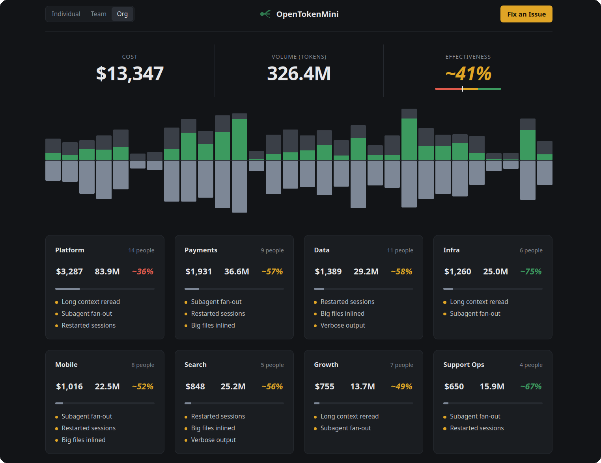

<!-- Generated by .github/pages/i18n.py from README.md: edit the English source and strings.json, not this file -->

#  OpenTokenMini

[English](../../../README.md) · [中文](../zh/README.md) · [Español](README.md)

Sabé cuánto cuestan tus agentes de IA y qué obtenés a cambio. Sitio: [opentokenmini.org](https://opentokenmini.org/)

OpenTokenMini mide cuánto cuesta cada llamada de tus agentes, cuánto tarda y dónde falla, lo vincula con los commits que produjo y se lo devuelve al agente para que delegue mejor. Funciona con Claude Code, Codex, modelos abiertos o una mezcla, para una persona, un equipo o una empresa. Libre y de código abierto: podés leer todo lo que recolecta.

## Probalo

Pegá esto en tu agente de código:

```
Clone https://github.com/OpenTokenMini/opentokenmini and follow its AGENTS.md
```

Explica cada paso y pregunta antes de activar cualquier cosa. No se recolecta nada antes de eso, y por defecto nunca se recolectan prompts ni código. Agregá lo que quieras al prompt, como "solo Claude Code" o "mandalo a nuestro Grafana".



<!-- TODO: link 00-docs/demo/ once usage.json is reviewed -->

## Una persona, equipos y organizaciones

- **Una persona**: corre en tu máquina, sin servidor.
- **Equipos**: un servidor chico propio (Docker Compose en una VM). El gasto por persona lo ve solo esa persona; el equipo ve los totales.
- **Organizaciones**: mandalo al backend que ya usan (Datadog, Grafana, un collector de OpenTelemetry), con login corporativo y equipos.

## Arquitectura

Los agentes de código reportan cada llamada por OpenTelemetry, que la mayoría ya habla. Un collector la guarda en tu máquina, en un servidor del equipo o en el backend de tu organización. Los dashboards, el análisis y un servidor MCP para agentes leen de ahí. Detalles: [cómo funciona](../overview.md)


## Resultados

Casos medidos de equipos que lo usan, y cómo sumar el tuyo: [reportes de casos](../../use-case-reports/)

## ¿Necesitás ayuda?

Despliegue, login corporativo o encontrar en qué se van tus tokens: [contactanos](https://forms.gle/cqjyqVN9qky4gQ5U6)

