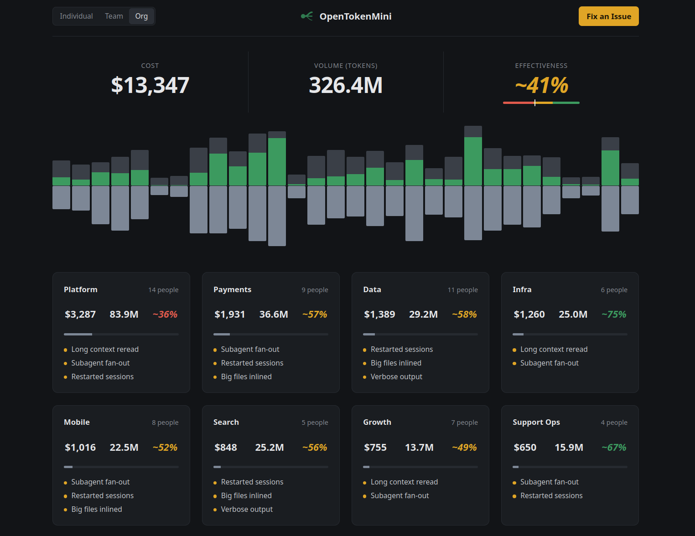

# Dashboards

`reference/` is the reference dashboard: the layout every view should follow. It runs on sample data.

Open `reference/index.html` in a browser, or run `python3 reference/serve.py` (http://127.0.0.1:7844/, logs browser errors to `/tmp/otm-dashboards-console.jsonl`).

- Individual / Team / Org switch the level: sessions, people or teams.
- Cost and volume are measured sums over the window; effectiveness is inferred (method still open). Hover any number to see how it was computed.
- Histogram: one bar per day. Above the axis, token volume colored by effectiveness (red to green); below it, cost.
- Click a card to inspect it; Fix opens the same inspector with the cursor in the fix box.

`standalone/` is the earlier page wired to real data; it will be rebuilt on this layout.
