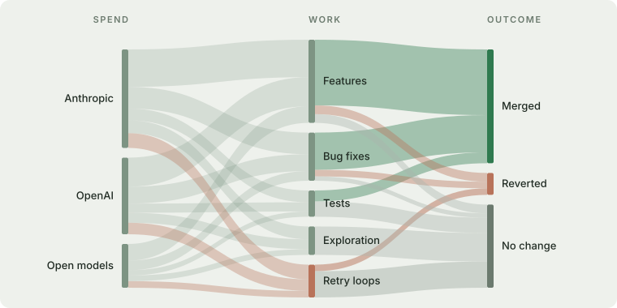

#  OpenTokenMini

[English](README.md) · [中文](00-docs/humans/zh/README.md) · [Español](00-docs/humans/es/README.md)

Know what your AI agents cost, and what you get for it.

For one developer, a team or a whole company, on Claude Code, Codex, Gemini CLI or a mix: OpenTokenMini records what every call costs, how long it takes and where it fails, links that to the commits and pull requests it produced, and shows where the spend goes and what to change. It works the same across agents and models, and it's open source: you can read everything it collects.



<!-- TODO: 00-docs/humans/dashboard.png, then link 00-docs/demo/ once usage.json is reviewed -->

## Single user, teams and organizations

- **Single user**: runs on your machine, no server. See your own spend per repo, model and session.
- **Teams**: one small server you own (Docker Compose on a VM). Spend per person is opt-in and visible only to that person; the team sees totals.
- **Organizations**: send it to the backend you already run (Datadog, Grafana, an OpenTelemetry collector), add corporate login, map people to teams, and see adoption across areas and billing next to measured use.

## Try it

Paste this into your coding agent:

```
Clone https://github.com/OpenTokenMini/opentokenmini and follow its AGENTS.md
```

It explains each step and asks before turning anything on. Every step past the basic setup is optional. Add whatever you want to the prompt, like "only Claude Code", "send it to our Grafana" or "just show me last month".

Prompts and code are not collected. Nothing is collected before you turn it on.

## Results

Measured cases from teams using it, and how to add yours: [use case reports](00-docs/use-case-reports/)

## Need help?

Deployment, corporate login, or finding where your tokens go: [contact us](https://forms.gle/cqjyqVN9qky4gQ5U6)
